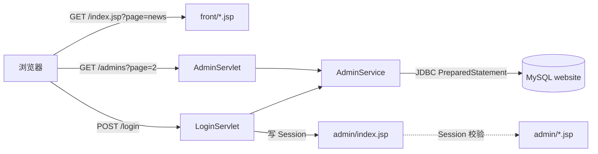

# CodeSkyWebsite

一个用 **原生 Servlet + JSP + JDBC** 写成的企业官网系统（前台展示站 + 后台管理），没有 Spring、没有 MyBatis、没有前端框架。目的是把 HTTP 请求生命周期、Session 会话、JDBC 访问、分页与多表 CRUD 这些底层机制跑通一遍。

> 这是一个 2025 年的课程实践项目，不是生产级系统。它的价值在于**结构完整、每一层都是手写的**；已知的限制在文末全部列出，没有隐藏。

## 技术栈

| 层次 | 选型 |
| --- | --- |
| 语言 | Java 8 |
| Web 容器 | Tomcat 7（`tomcat7-maven-plugin` 2.2，端口 8080，context path `/`） |
| 视图 | JSP + JSTL 脚本片段，手写 CSS（410 行，无 UI 框架） |
| 控制层 | Servlet 3.0 注解（`@WebServlet`），7 个 Servlet |
| 持久层 | 原生 JDBC + `PreparedStatement`，无 ORM |
| 数据库 | MySQL 8（`utf8mb4`），3 张表 |

规模：17 个 Java 文件 1339 行、20 个 JSP 1589 行、1 个 CSS 410 行。

## 快速开始

前置：JDK 8+、Maven 3.6+、MySQL 5.7+（建表脚本按 MySQL 8 严格模式写，零值默认时间已去掉）。

```bash
# 1. 建库建表 + 初始数据
mysql -u root -p < sql/schema.sql
mysql -u root -p < sql/seed.sql

# 2. 配置数据库连接（三选一，优先级从高到低）
#    a) 环境变量
export DB_URL='jdbc:mysql://localhost:3306/website?useUnicode=true&characterEncoding=utf-8&serverTimezone=Asia/Shanghai&useSSL=false'
export DB_USER=root
export DB_PASSWORD='你的口令'
#    b) 启动参数
#       mvn tomcat7:run -Djdbc.user=root -Djdbc.password=xxx
#    c) 直接改 src/main/resources/db.properties（本地开发最省事）

# 3. 启动（会下载依赖并拉起内嵌 Tomcat）
mvn tomcat7:run

# 4. 访问
#    前台 http://localhost:8080/
#    后台 http://localhost:8080/admin/login.jsp    默认账号 root / 123456
```

默认账号的 SHA-256 摘要写在 `sql/seed.sql` 里，**部署到公网前请先改掉口令**。

## 目录结构

```
src/main/java/fun/zengxp/
├── AdminServlet.java        管理员管理（列表分页 / 增删改）
├── LoginServlet.java        登录校验，写 Session
├── ExitServlet.java         退出登录
├── NewsServlet.java         新闻列表 + 增删改
├── NewsEdit.java            新闻编辑页
├── NewsDetailServlet.java   前台新闻详情
├── NoticeServlet.java       公告 CRUD（含正文外链文件）
├── pojo/                    Admin / News / Notice 三个实体
├── service/                 业务逻辑 + SQL（AdminService / NewsService / NoticeService）
└── Util/                    DBConnection 连接工厂
src/main/resources/
└── db.properties            数据库连接配置
src/main/webapp/
├── index.jsp                入口，按参数转发到前台子页
├── front/                   前台：首页、产品、新闻、公告、关于、联系我们
├── admin/                   后台：登录、管理员、新闻、公告、个人资料
├── css/main.css             全站样式
└── img/                     静态资源
sql/
├── schema.sql               建库建表（admin / news / notice）
└── seed.sql                 初始数据
```

## 请求链路



前台是「一个入口 JSP + 参数路由」，后台是「Servlet 处理表单 + JSP 渲染」——两种风格都保留着，因为它们对应我当时理解的两种写法。

## 功能清单

**前台**：首页轮播与产品展示、产品列表、新闻列表与详情、公告列表、关于我们、联系我们、背景切换。

**后台**：登录 / 退出、管理员列表（分页）、管理员增删改、新闻增删改、公告增删改、个人资料、登录时间记录。

## 数据库

`admin`（管理员，口令存 SHA-256 摘要）、`news`（新闻）、`notice`（公告）。字段与索引见 `sql/schema.sql`，每个字段都有注释。

## 已知限制

按影响排序，都是真实存在的，没有粉饰：

1. **口令无盐 SHA-256**：`AdminService#hashPassword` 只做了一次 SHA-256，没有 salt。彩虹表可直接反查。
2. **没有统一的登录拦截**：只有 `admin/index.jsp` 和 `profile.jsp` 里做了 Session 判断，其余后台页面直接访问可见。正确做法是一个 `Filter` 统一拦截 `/admin/*`。
3. **连接未池化**：每次请求 `DriverManager.getConnection` 新建连接，异常路径上还会漏关（部分方法没有 try-with-resources）。量小的时候不炸，但这是错的。
4. **错误处理粗糙**：多处 `e.printStackTrace()`，失败时给用户的是空白页或 `alert` 脚本，没有统一错误页。
5. **Servlet 版本不一致**：编译按 Servlet 4.0 引 jar，实际运行在 Tomcat 7（Servlet 3.0）。目前语法上都兼容，但版本对不上。
6. **SQL 直接写在 Service 里**：没有 DAO 层，换数据库或加缓存要改业务代码。
7. **测试是 `main()` 方法**：`AdminTest` / `NewsServiceTest` 直接 `main` 跑，没有断言框架，`pom.xml` 里声明的 JUnit 3.8.1 实际没被使用。

### 下一步（如果继续做）

Filter 统一鉴权 → 口令改 `PBKDF2/bcrypt` 加盐 → HikariCP 连接池 → DAO 层抽离 → JUnit 5 + 真实断言 → 迁移到 Spring Boot。

## 其他

- 项目里 `src/main/webapp/img/` 约 2.8 MB 静态图，其中部分与功能无关，可以裁剪。
- 提交历史早期包含一次 `.idea/` 误提交，现已通过 `.gitignore` 排除。
